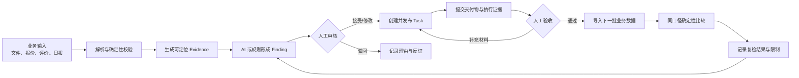
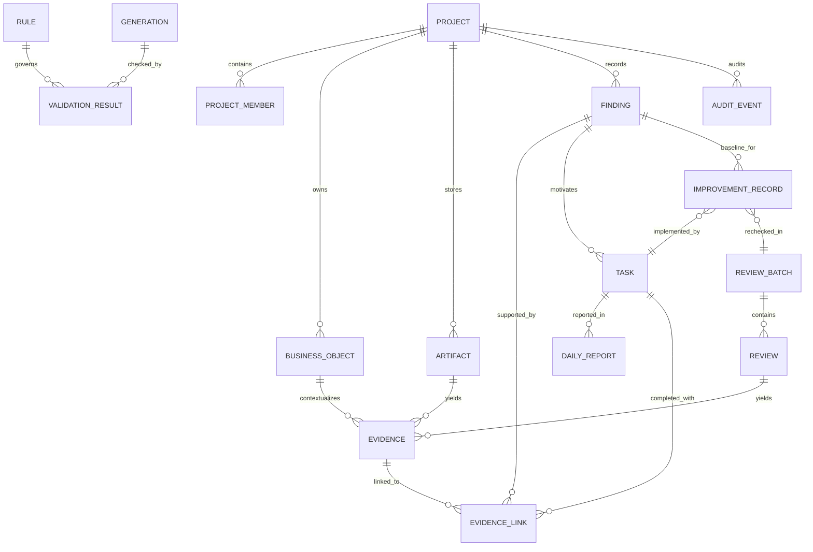
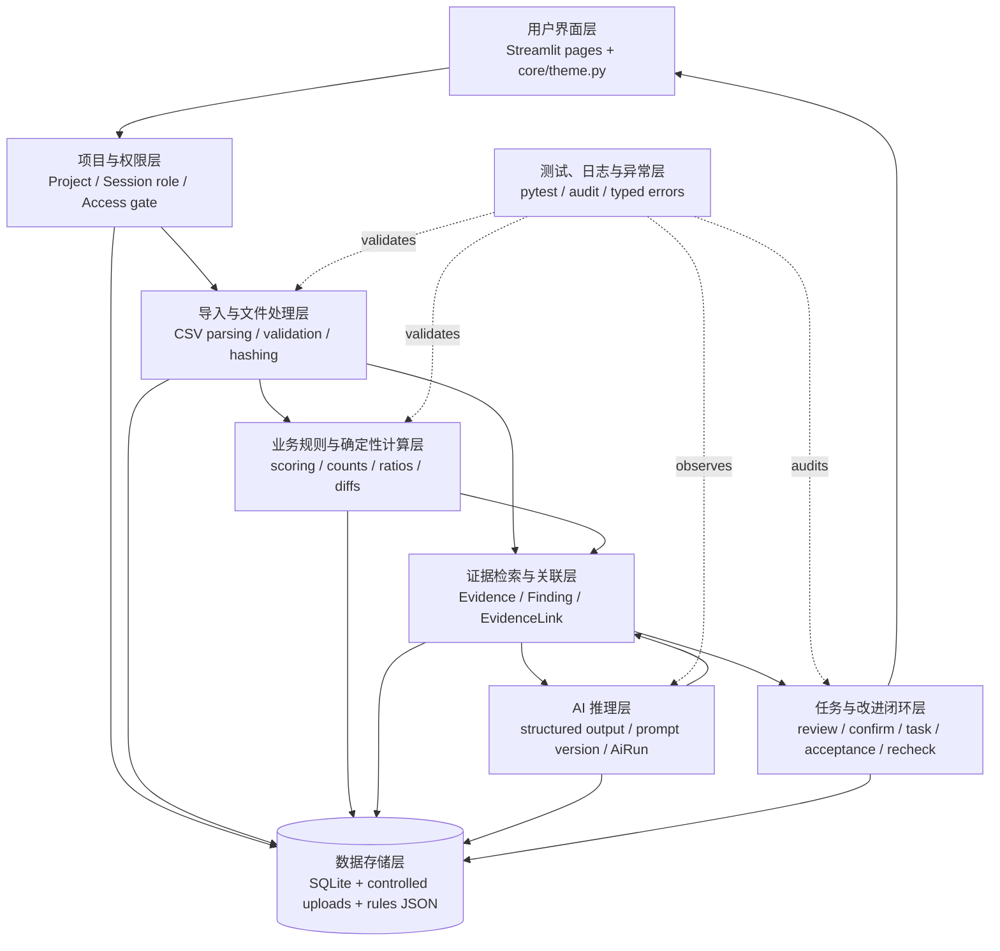
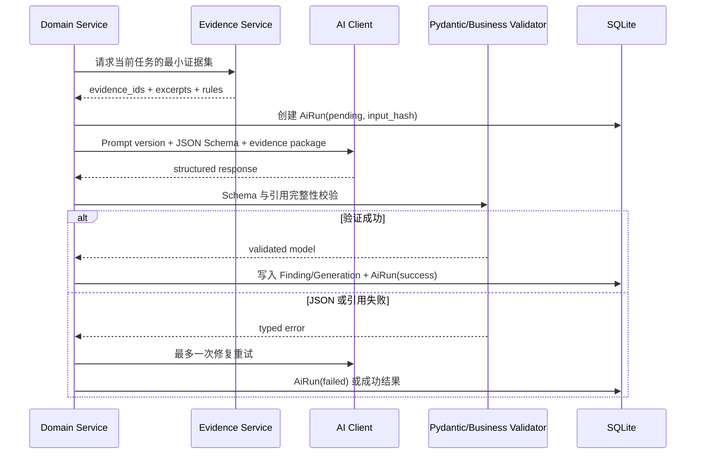
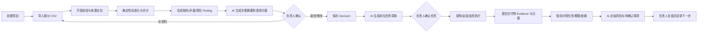
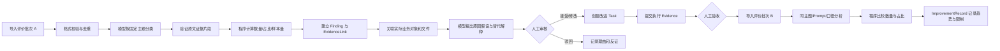

# TradeLoop 项目架构：以证据链驱动跨境业务持续改进

> 文档状态：目标架构与 36 小时实施基线  
> 代码基线：`2059026 feat: refresh brand UI and harden access flow`  
> 最近核对日期：2026-10-25  
> 文档边界：本文件描述当前事实、目标设计和实施优先级；尚未实现的能力不会被表述为已完成。

## 阅读约定

本文使用以下状态标记，避免把设计目标与现有能力混在一起：

| 标记 | 含义 |
|---|---|
| **已实现** | 当前仓库中已有可运行代码，并有相应页面、服务或测试支撑 |
| **模型骨架** | 数据表或页面入口已经存在，但尚未形成可运行的业务闭环 |
| **本次建议** | 为证据链闭环提出的目标设计，尚未进入代码 |
| **未来扩展** | 不属于 36 小时 P0，赛后再验证或建设 |

---

## 1. 项目定位与核心创新假设

### 1.1 产品定位

TradeLoop 是一个**面向中小跨境电商团队的证据驱动型业务协同与持续改进系统**。

它试图把供应商报价、商品资料、项目文件、跨岗位任务、日报、客户评价和目标市场规则关联在同一个项目空间中，让 AI 不只生成内容，而是辅助团队完成：

```text
发现问题 → 查看证据 → 区分事实与假设 → 人工审核
→ 创建任务 → 提交交付物 → 验收 → 导入后续数据复检
```

### 1.2 核心创新假设

本项目的核心假设是：当 AI 的每项重要判断都能关联原始业务证据、规则来源、人工审核和后续任务时，中小跨境团队可以减少手工汇总、无依据判断和跨岗位信息断层。

该假设尚未被真实客户、长期业务数据或竞品调查充分验证。黑客松版本只能证明技术链路和交互闭环可运行，不能直接证明：

- TradeLoop 具有行业首创性；
- 用户一定愿意迁移现有 Excel、群聊和 ERP 流程；
- AI 建议一定提高转化率、降低成本或改善质量；
- 评价指标变化一定由某项改进措施造成。

### 1.3 产品原则

1. **证据先于结论。** 每项重要发现必须说明数据来源和定位方式。
2. **事实、判断、假设和未知分离。** 不把客户表达、模型分类和原因推测混写。
3. **确定性计算由程序完成。** 频次、比例、评分、去重、状态转换和版本差异不交给模型自由计算。
4. **关键操作必须人工确认。** 供应商选择、任务发布、风险关闭、合规判断和改进验收不由 AI 自动决定。
5. **结果必须可执行。** 洞察需要能够转为任务、责任岗位、交付物和验收标准。
6. **复检不等于因果证明。** 前后变化只能描述观察到的趋势，并显示样本和限制。
7. **最小必要上下文。** 模型只接收与当前问题有明确关联的证据和规则，不发送整个项目的全部文件。

---

## 2. 当前代码实现盘点

### 2.1 当前技术栈

| 层 | 当前实现 |
|---|---|
| 用户界面 | Streamlit 1.66 多页面应用 |
| 语言 | Python 3.12（兼容目标为 Python 3.11/3.12） |
| 数据库 | SQLite + SQLAlchemy 2.x |
| 输入校验 | Pydantic 2.x |
| 数据处理 | Pandas |
| 配置 | `python-dotenv`、`.streamlit/config.toml` |
| 测试与质量 | pytest、Ruff |
| 文件存储 | `data/uploads/<project_id>/` 本地目录 |
| AI 接入 | 尚未实现；仅保留环境变量、`AiRun` 模型和 Prompt 目录 |
| 规则库 | `data/rules.json` 演示占位数据，来源尚未确认 |

### 2.2 已实现能力

| 能力 | 代码位置 | 当前边界 |
|---|---|---|
| 创建项目 | `pages/01_项目首页.py`、`services/project_service.py` | 支持项目名、产品名、US/DE 市场、访问码 |
| 演示项目 | `scripts/seed_demo.py`、`data/demo/` | 可重复创建演示项目并导入报价 |
| 访问码保护 | `services/project_service.py`、`core/ui.py` | PBKDF2-SHA256、随机盐、恒定时间比较；浏览器 Session 级失败锁定 |
| 报价 CSV 预览与校验 | `services/imports.py` | 固定字段；检查缺列、类型、空值、重复供应商和混合币种 |
| 文件追踪 | `Artifact`、`services/imports.py` | 保存原始文件名、存储路径、SHA-256、解析状态和批次 |
| 重复导入保护 | `services/imports.py` | 相同项目、类型和 SHA-256 的报价文件不重复导入 |
| 供应商比较 | `services/supplier_scoring.py` | 价格、MOQ、交期 min-max 归一化；质量风险关键词扣分 |
| 可解释排名 | `pages/02_报价决策.py` | 展示原始值、分项得分、总分和命中风险词 |
| 基础审计 | `AuditEvent` | 已记录项目创建和报价导入；覆盖范围仍很小 |
| 品牌前端 | `core/theme.py`、`assets/harbor-hero.svg` | 统一主题、导航、页面头部和响应式样式 |
| 自动验证 | `tests/` | 15 项测试覆盖导入、评分、访问码和页面启动 |

### 2.3 已有但尚未完成的能力

下列实体会由 `Base.metadata.create_all()` 建表，但没有完整服务或业务页面，因此只能称为**模型骨架**：

| 实体/页面 | 已有内容 | 尚缺内容 |
|---|---|---|
| `Decision` | 供应商人工选择字段 | 决策服务、确认页面、证据关联和审计 |
| `Task` | 标题、岗位、状态、验收标准、依赖、确认字段 | 创建/编辑/确认/状态转换、交付物、审核证据 |
| `DailyReport` | 完成项、证据文本、阻塞、计划字段 | 提交页面、任务对照、风险复盘和引用验证 |
| `ReviewBatch` / `Review` | 批次和评价基础字段 | CSV 导入、去重、批量分类和证据定位 |
| `Insight` | 主题、数量、占比、置信度、评价 ID 列表 | 事实/判断/假设区分、人工审核、反证和任务关联 |
| `Generation` | 市场、语言、版本、父版本、反馈 | 真实模型调用、两轮修改、差异展示 |
| `ValidationResult` | 规则 ID、原文片段、严重度、建议 | 规则加载、确定性检查、语义校验和来源展示 |
| `AiRun` | 模型、Prompt 版本、输入哈希、状态和错误码 | 统一模型客户端、结构化输出、超时和重试 |
| 任务、差评、本地化页面 | 品牌页头、项目访问检查和占位说明 | 实际业务组件与服务调用 |

### 2.4 当前数据模型的主要差距

- 没有 `Member` 或项目成员关系，角色只是 Streamlit Session 中的演示选择。
- `Project.product_name` 是字符串，商品、供应商、订单、批次尚未成为可关联业务对象。
- `Artifact` 能追踪文件，但不能定位工作表、行、列、段落或原文片段。
- `Insight.evidence_review_ids_json` 只能引用评价 ID，无法统一引用文件字段、规则或任务交付物。
- `Task.source_type/source_id` 是单一、弱约束来源，无法表达一个任务由多个发现和证据共同产生。
- 没有通用 `Finding`，供应商风险、日报风险和评价问题无法使用相同审核语义。
- 没有 `ImprovementRecord`，无法持久化基线、措施、验收和复检结果。
- `Rule` 还不是数据库实体；当前两条规则的来源为 `TO_BE_CONFIRMED`，不能用于正式合规结论。
- `AuditEvent.actor_role` 记录岗位文本，而不是经过认证的成员身份。
- SQLite 通过 `create_all()` 建表，没有迁移机制；后续改模型需谨慎处理已有本地数据库。

---

## 3. 目标业务流程

### 3.1 统一闭环



### 3.2 信息认识状态

每条重要发现必须使用以下一种认识状态：

| 状态 | 定义 | 示例 |
|---|---|---|
| `confirmed_fact` | 输入数据或人工材料可以直接证明 | “批次 A 的 50 条评价中，8 条包含包装破损表达” |
| `model_judgment` | 模型按照给定分类口径做出的判断 | “评价 R-018 被归入包装破损主题” |
| `causal_hypothesis` | 对可能原因的待验证解释 | “外箱强度可能不足” |
| `unknown` | 当前数据无法确认 | “无法判断破损发生在供应商装箱还是末端物流” |

一个 Finding 可以包含多个陈述，但 UI 必须分别展示其状态，不能用一个“AI 分析结论”卡片混合呈现。

### 3.3 人工审核状态

建议统一为：

```text
draft → pending_review → accepted / revised / rejected
                         ↓
                    task_created
```

- `draft`：模型或规则产生，尚未提交审核。
- `pending_review`：证据齐全，等待负责人确认。
- `accepted`：结论和证据被接受。
- `revised`：负责人修改了结论、分类或范围。
- `rejected`：结论被驳回，必须记录理由。
- `task_created`：基于已审核 Finding 创建了任务，不代表任务完成。

---

## 4. 模块职责与深化方向

### 4.1 项目工作空间

**当前：** 已实现项目创建、US/DE 市场、演示身份、访问码和项目级文件目录；未实现成员、讨论、文件版本和权限。

**目标职责：**

- 保存项目范围、市场、成员、岗位和状态。
- 管理项目文件、业务对象、讨论、任务和审计事件。
- 为每个模型调用限定 `project_id`，防止跨项目数据串用。
- 让文件、证据、Finding、Task 和业务对象可以互相追溯。

**36 小时实现：** 使用演示角色切换；项目留言可以是简单时间线，不做 WebSocket；访问码只是辅助入口，不宣称代替身份认证。

### 4.2 供应商报价决策

**当前：** 已实现固定模板、单币种校验、SHA-256 去重、确定性加权评分和解释展示。

**深化方向：**

- 为每个报价字段记录来源：文件 ID、行号、列名和原始值。
- 标准化币种、计量单位、数量、MOQ、交期、付款条件和交付条件。
- 明确区分“已标准化可比较”“原文保留不可直接比较”“缺失”“矛盾”。
- 运输、关税、保险等未提供数据只显示未知，不计算虚假到岸总成本。
- 将缺失字段、矛盾条款和风险词生成 Finding，再由负责人决定是否转为澄清任务。
- 确定性评分和模型建议并列展示；AI 不覆盖评分结果。

### 4.3 AI 岗位任务分配

**当前：** `Task` 表存在，页面为占位。

**目标职责：**

- 从已审核 Finding 或人工决定生成任务草稿。
- 任务至少包含目标、责任岗位、前置条件、截止日期、交付物和验收标准。
- 支持依赖和阻塞状态。
- 任务必须关联产生它的 Finding、Evidence 或 Rule。
- 负责人确认后才从 `draft` 变为 `todo`。
- 完成任务时提交交付物 Evidence；没有证据时显示 `evidence_missing`，不自动判定为完成。

### 4.4 每日汇报与项目复盘

**当前：** `DailyReport` 表存在，页面为占位。

**目标职责：**

- 日报引用已存在的任务，而不是只提交自由文本。
- 程序先比较任务状态、截止日期、依赖和交付物存在性。
- 模型负责总结跨岗位冲突、资料缺口和待确认事项。
- 每项重要风险必须关联任务、日报字段或交付物 Evidence。
- 缺少日报或交付物只能标为“资料缺失”，不能直接评价员工表现。

### 4.5 客户差评与质量改进

**当前：** 有两批演示 CSV 和 `ReviewBatch/Review/Insight` 模型，尚无导入与分析服务。

**目标职责：**

1. 校验并导入评价批次。
2. 固定主题字典下进行多标签分类。
3. 程序计算主题数量、占比和样本量。
4. 保存每条模型分类及其原文证据片段。
5. 形成 Finding，并明确事实、模型判断、原因假设和未知信息。
6. 尝试关联实际存在的 SKU、供应商、订单或批次；无法关联时明确显示。
7. 人工审核后生成调查或改进任务。

重要边界：

- “评价提到包装破损”不等于“供应商造成包装破损”。
- 模型返回的证据片段必须是评价原文的连续子串；代码负责验证。
- 没有订单、销量或批次总量时，评价占比不是商品故障率。
- 没有实际关联字段时，不得猜测评价对应哪个供应商或生产批次。

### 4.6 改进任务与效果复检

**当前：** 没有 `ImprovementRecord`；可复用 `Task`、`ReviewBatch` 和 `Insight` 骨架。

**目标职责：**

- 保存基线批次、主题、数量、占比、分母含义和样本范围。
- 保存改进任务、执行证据、验收结果和验收人。
- 后续批次必须复用相同主题字典、Prompt 版本和统计口径。
- 代码计算数量变化和占比变化；样本不足时返回“暂不能判断”。
- 复检结果只描述关联变化，不宣称措施造成结果。

### 4.7 美国与德国本地化和规则校验

**当前：** `Generation/ValidationResult` 模型和页面骨架存在；`rules.json` 只有来源待确认的演示规则。

**目标职责：**

- 同一已确认事实生成美国英语与德国德语内容。
- 保存 V1、用户反馈、V2 和父版本关系。
- 确定性正则规则与模型语义检查分开执行。
- 每个校验结果引用检查对象片段和 Rule ID。
- Rule 记录市场、平台、类别、来源、版本和更新时间。
- 无来源、过期或不覆盖的规则输出“待人工审核”，不输出“保证合规”。

---

## 5. 统一数据模型

### 5.1 设计策略

现有表不全部推翻。P0 采取“复用 + 少量新增 + 明确关联”的策略：

- `Project` 保留。
- `Artifact` 演进为文件记录 `FileRecord` 的职责，代码中暂可继续使用原表名。
- `SupplierQuote` 保留并补充来源定位字段或关联 Evidence。
- `Insight` 保留为评价主题聚合结果；新增通用 `Finding` 表达跨模块发现。
- `Task`、`DailyReport`、`ReviewBatch`、`Review`、`Generation`、`ValidationResult`、`AiRun`、`AuditEvent` 继续复用。
- P0 最小新增：`BusinessObject`、`Evidence`、`Finding`、`EvidenceLink`、`ImprovementRecord`。
- `Member/Role` 先保留目标模型和演示角色映射，正式成员认证放入 P1。

### 5.2 核心实体职责

| 实体 | 状态 | 职责与关键字段 |
|---|---|---|
| `Project` | 已实现，需扩展 | 项目边界；`id, name, markets, status, created_at` |
| `Member` / `ProjectMember` / `Role` | 本次建议 | 真实成员身份、项目角色和权限；演示期可由 Session 角色替代 |
| `BusinessObject` | 本次建议 | 统一表示 product、supplier、order、production_batch、shipment；只为实际存在的数据创建 |
| `Artifact`（FileRecord 职责） | 已实现，需扩展 | 文件、版本、哈希、解析状态；建议增加 `version, parent_id, mime_type, source_label` |
| `SupplierQuote` | 已实现，需扩展 | 标准化报价字段；通过 Evidence 保存行列来源和原始值 |
| `Evidence` | 本次建议，P0 | 可追溯原始依据；保存来源类型、来源实体、定位器、原文片段、哈希和时间 |
| `Finding` | 本次建议，P0 | 问题、异常、风险或未知项；保存认识状态、审核状态、统计口径和模型版本 |
| `EvidenceLink` | 本次建议，P0 | 将 Evidence 与 Finding、Task、Decision、ImprovementRecord 等关联 |
| `Rule` | JSON 骨架，需演进 | 规则内容、类别、适用范围、来源、版本、更新时间和有效性状态 |
| `Decision` | 模型骨架 | AI 建议、人工选择、理由、确认时间；关联报价 Finding 与 Evidence |
| `Task` | 模型骨架，需扩展 | 目标、岗位、状态、依赖、交付物要求、验收标准和人工确认 |
| `DailyReport` | 模型骨架 | 与 Task 对照的完成项、证据、阻塞和下一步 |
| `ReviewBatch` / `Review` | 模型骨架 | 评价批次、原始评价、市场、SKU 和外部 ID |
| `Insight` | 模型骨架 | 某评价批次中主题的确定性聚合：数量、占比、样本量 |
| `ImprovementRecord` | 本次建议，P0 | 基线、改进任务、验收、复检批次、前后指标和解释限制 |
| `Generation` / `ValidationResult` | 模型骨架 | 内容版本、反馈、校验命中和修改建议 |
| `AiRun` | 模型骨架 | 真实调用的模型、Prompt、输入哈希、状态、耗时和错误 |
| `AuditEvent` | 部分实现 | 记录关键用户行为、审核和状态变化；未来 actor 应关联 Member |

### 5.3 证据定位字段

建议 `Evidence` 至少包含：

```text
id
project_id
evidence_type           # review_text / file_cell / file_excerpt / task_delivery / rule_source
source_entity_type      # review / artifact / quote / daily_report / task / rule
source_entity_id
locator_json            # 行列、sheet、页码、段落、review_id、字段名等
excerpt                 # 最小必要原文片段
content_hash            # 去重和防止静默变化
business_object_id?     # 仅在实际可关联时填写
observed_at?
created_at
```

`locator_json` 示例：

```json
{
  "artifact_id": 12,
  "sheet": "Supplier Quotes",
  "row": 8,
  "column": "lead_time_days",
  "raw_value": "18 days"
}
```

评价证据示例：

```json
{
  "review_id": "R-018",
  "batch_id": 4,
  "char_start": 23,
  "char_end": 51,
  "excerpt": "The box arrived crushed"
}
```

### 5.4 Finding 字段

建议 `Finding` 至少包含：

```text
id
project_id
finding_type            # quote_risk / review_theme / schedule_risk / rule_violation / unknown
statement
epistemic_status        # confirmed_fact / model_judgment / causal_hypothesis / unknown
review_status           # draft / pending_review / accepted / revised / rejected
confidence?
sample_size?
denominator_value?
denominator_type?       # reviews / orders / units / unknown
time_window_start?
time_window_end?
model_run_id?
reviewed_by_member_id?
reviewed_at?
review_note?
created_at
```

### 5.5 核心关系



图中是目标关系，不表示对应表已经全部存在。

### 5.6 差评问题到任务的关联

```text
ReviewBatch
  → Review
  → Evidence(review_id + 原文片段)
  → Finding(review_theme / model_judgment)
  → 人工审核 accepted/revised
  → Task(source finding)
  → Evidence(task_delivery)
  → 人工验收
  → ImprovementRecord
  → 后续 ReviewBatch
```

任务不能只保存一个模糊的 `source_id`。P0 可继续保留原字段以兼容，但应以 `EvidenceLink` 记录多来源，并由服务层校验被引用实体属于同一 `project_id`。

### 5.7 人工审核与改进结果

- Finding 保存审核人、状态、时间、修改后文本和理由。
- Task 保存发布人、确认状态和验收标准。
- 任务交付物作为 Evidence 关联 Task。
- ImprovementRecord 保存基线、执行任务、验收结果、后续批次和统计差异。
- 审核、发布、驳回、完成和验收均写入 AuditEvent。

### 5.8 防重复策略

| 对象 | 幂等键/策略 |
|---|---|
| 文件 | 已实现：`project_id + artifact_type + sha256` |
| 评价 | 建议唯一约束：`review_batch_id + external_id`；没有外部 ID 时使用规范化文本哈希 |
| Evidence | `project_id + source_entity_type + source_entity_id + locator_hash + content_hash` |
| AI 分析 | `input_hash + prompt_version + model + taxonomy_version`，成功结果可复用 |
| Finding | `analysis_run_id + finding_type + normalized_statement_hash` |
| 改进任务 | `finding_id + task_template_version + owner_role`；重复创建前提示用户 |
| Generation | `project_id + market + parent_id + feedback_hash + prompt_version` |

重复导入被拦截不等于静默忽略：UI 应告诉用户发现了哪个已有记录，并允许打开它。

---

## 6. 证据链设计

### 6.1 证据链对象

完整的证据链至少包括：

```text
原始来源
→ 可定位 Evidence
→ 结构化事实或模型分类
→ Finding
→ 人工审核
→ Task
→ 执行 Evidence
→ 人工验收
→ 后续数据与 ImprovementRecord
```

### 6.2 差评 Finding 示例

**事实：**

```text
Finding F-101
状态：confirmed_fact
陈述：批次 A 共 50 条评价，其中 8 条经审核包含包装破损表达，占 16%。
分母：reviews=50
证据：R-003、R-008、R-018……的原文片段
```

**模型判断：**

```text
Finding F-102
状态：model_judgment
陈述：模型将 R-018 归入“包装破损”主题。
证据：R-018 原文连续子串
Prompt：review_classify_v1
人工状态：pending_review
```

**原因假设：**

```text
Finding F-103
状态：causal_hypothesis
陈述：外箱抗压强度不足可能是原因之一。
支持：包装破损评价 + 当前包装规范文件
反证/替代解释：末端物流挤压、消费者储存、抽样偏差
未知：无法关联具体物流节点和生产批次
```

禁止把 F-103 改写为“供应商包装不合格导致破损”，除非有额外材料经过人工确认。

### 6.3 证据完整性检查

由普通程序逻辑执行：

- 评价证据片段必须是原文子串。
- 文件证据定位器必须指向存在的 Artifact 和合法字段/行。
- Rule ID 必须存在，且市场与当前生成对象一致。
- 所有引用实体必须属于同一项目。
- Finding 的 `confirmed_fact` 必须至少有一个可验证 Evidence。
- `sample_size`、分母和占比必须由程序重新计算，不相信模型给出的数字。
- 被修改的原始文件通过 SHA-256 产生新版本，不静默覆盖旧版本。

### 6.4 反证与未知信息

Finding UI 应固定显示四栏：

1. 已知事实。
2. 模型判断或原因假设。
3. 支持证据与反证。
4. 仍需补充的信息。

当业务资料无法关联时，`business_object_id` 保持为空，并显示“未能关联订单/批次”，而不是让模型猜测。

### 6.5 证据链质量指标

这些是系统质量指标，不是业务效果承诺：

- 重要 Finding 的可定位证据覆盖率。
- 模型引用片段原文验证通过率。
- 已审核 Finding 占提交审核 Finding 的比例。
- 任务拥有明确验收标准的比例。
- 已完成任务拥有交付 Evidence 的比例。
- 复检记录包含样本量、分母和口径说明的比例。
- 重复导入和重复任务的拦截数量。

---

## 7. 系统架构与数据流

### 7.1 分层架构

继续采用 Streamlit 单体应用，不为黑客松引入微服务、消息队列、独立向量数据库或多智能体框架。



### 7.2 层级职责与输入输出

| 层 | 输入 | 输出 | 主要模块 |
|---|---|---|---|
| UI | 用户表单、上传、反馈、审核操作 | 页面状态、调用服务命令 | `app.py`, `pages/`, `core/ui.py`, `core/theme.py` |
| 项目和权限 | 当前用户/演示角色、项目选择、访问凭据 | 已授权 project context | `project_service.py`；未来 `auth_service.py` |
| 导入与文件处理 | CSV/文本/PDF（若支持） | Artifact、结构化行、解析错误、SHA-256 | `services/imports.py`；未来 `review_imports.py` |
| 确定性计算 | 已验证结构化数据 | 分数、频次、比例、差异、规则命中 | `supplier_scoring.py`；未来 `review_metrics.py`, `rule_engine.py` |
| 证据检索与关联 | 当前业务对象、Finding、Task | 最小 Evidence 集、来源定位、关联图 | 未来 `evidence_service.py` |
| AI 推理 | 最小证据包、固定规则、JSON Schema | 结构化分类、摘要、假设、任务草稿 | 未来 `ai_client.py` 与 Prompt 文件 |
| 任务和改进 | 已审核 Finding、任务状态、交付 Evidence | Task、验收、ImprovementRecord、复检 | 未来 `task_service.py`, `improvement_service.py` |
| 存储 | 事务化业务对象和文件 | SQLite 记录、本地受控文件 | `core/db.py`, `core/models.py`, `data/` |
| 测试与异常 | 服务输入、故障注入 | 测试结果、AiRun、AuditEvent、可理解错误 | `tests/` 与统一错误类型 |

### 7.3 程序逻辑、模型与人工职责

| 事项 | 普通程序 | 大模型 | 人工审核 |
|---|---:|---:|---:|
| CSV 字段和类型校验 | ✓ |  | 仅处理异常数据 |
| 文件哈希与重复检测 | ✓ |  |  |
| 汇率和单位标准化 | ✓，但需可靠输入源 |  | 确认无法映射项 |
| 供应商分项得分和总分 | ✓ |  | 确认最终供应商 |
| 评价数量、占比和前后差异 | ✓ |  | 确认统计口径 |
| 评价主题语义分类 | 规则可先筛选 | ✓ | 复核低置信和关键分类 |
| 原文证据子串验证 | ✓ | 只提出候选片段 | 处理不一致 |
| 原因假设和替代解释 |  | ✓ | 接受、修改或驳回 |
| 任务草稿和文字摘要 |  | ✓ | 确认后发布 |
| 截止日期计算和状态转换 | ✓ | 只给 offset 建议 | 可修改 |
| 规则正则命中 | ✓ |  | 处理误报 |
| 文化与语义风险检查 |  | ✓ | 最终判断 |
| 供应商责任、员工绩效、法律合规 |  | 不得自动决定 | ✓，且需额外依据 |

### 7.4 AI 结构化调用

统一调用流程：



建议统一错误码：

```text
VALIDATION_ERROR
FILE_PARSE_ERROR
DUPLICATE_IMPORT
MODEL_TIMEOUT
MODEL_BAD_JSON
MODEL_INVALID_REFERENCE
RULE_NOT_FOUND
NO_RULE_COVERAGE
DATABASE_ERROR
```

### 7.5 最小上下文检索

不把整个项目文件夹传给模型。上下文选择顺序：

1. 由当前 `project_id` 限定范围。
2. 根据当前业务动作确定对象，例如某个 ReviewBatch 或报价 Artifact。
3. 通过 EvidenceLink 获取明确关联证据。
4. 根据目标市场和类别选择有效 Rule。
5. 只传原文必要片段、字段值和稳定 ID。
6. 记录实际传入的 Evidence ID 和 input hash。

P0 数据规模较小，不需要向量数据库。结构化查询、主题字典、标签和显式关联更可控。只有赛后文件量明显增长且结构化关联不足时，才评估向量检索。

### 7.6 异常处理

| 异常 | 系统行为 |
|---|---|
| 文件缺列或类型错误 | 显示行号/字段；不写入业务表；不调用模型 |
| 文件解析中途失败 | Artifact 标记失败；保留错误信息；不产生半成品分析 |
| 重复文件 | 返回已有 Artifact，提示重复来源和导入时间 |
| 模型超时 | AiRun 记录失败；保留输入；允许用户重试 |
| 模型 JSON 错误 | 一次结构修复重试；仍失败则显示可理解错误 |
| 模型引用不存在的 ID | 业务校验拒绝写入，记录 `MODEL_INVALID_REFERENCE` |
| 规则来源缺失 | 结果标记 `NO_RULE_COVERAGE`，要求人工审核 |
| 跨项目引用 | 服务层拒绝并写入安全审计 |
| 数据库写入失败 | 整个事务回滚，避免 Finding 与 Evidence 部分成功 |

---

## 8. 两条端到端工作流

### 8.1 工作流 A：供应商选择 → 项目执行 → 风险复盘



关键数据流：

- 报价文件生成 Artifact；每行字段形成或关联 Evidence。
- 确定性评分不由模型计算。
- AI 摘要只能引用存在的供应商、字段和 Evidence ID。
- Decision 保留 AI 建议与人工最终选择的差异。
- 任务关联 Decision、Finding 和 Evidence；确认前保持 `draft`。
- 日报不直接等于完成证据；Task 的交付物单独作为 Evidence。

P0 演示异常：删除报价必填列，系统在模型调用前停止并提示。

### 8.2 工作流 B：客户评价 → 证据核查 → 改进任务 → 下一批复检



关键数据流：

- 每条 Review 保留 `external_id` 和原文，不用模型改写原始数据。
- 模型返回 `review_id, themes, evidence_span, confidence`。
- 代码验证 evidence_span 是原文子串并重新聚合统计。
- 原因假设与已确认事实分别存储。
- 只有实际存在订单/批次字段时才创建 BusinessObject 关联。
- ImprovementRecord 同时保存批次 A/B 的样本量、数量、占比和口径。
- 页面使用“下降/上升趋势”而非“改进成功”，除非有更强实验设计和人工结论。

P0 演示异常：评价没有内部批次字段时，明确显示“无法关联生产批次”。

---

## 9. 比赛硬性要求与验收矩阵

以下性质基于现有团队赛题讨论稿；主办方未完整展示或后续更新的内容仍需以正式通知为准。

| 要求 | 性质 | TradeLoop 目标证据 | 当前状态 |
|---|---|---|---|
| 中文或目标语言输入 | 硬性 | 中文项目资料、反馈和操作界面 | 部分实现：中文 UI；生成未实现 |
| 至少两种目标语言，或两类角色/场景产出 | 硬性（二选一） | 美国英语、德国德语；负责人/采购/运营/品控 | 角色选择已实现；语言产出未实现 |
| 至少两个平台或市场/场景适配 | 硬性 | 美国市场 + 德国市场 | 市场字段已实现；适配逻辑未实现 |
| 至少两类规则校验 | 硬性 | 宣传承诺 + 文化语言；均引用 Rule | 未实现；演示规则来源待确认 |
| 至少两种反馈形式 | 硬性 | 文本批注 + 风险标签/版本差异 | 未实现 |
| 至少两轮对话式迭代 | 硬性 | Generation V1 → 用户反馈 → V2 | 模型骨架；未实现 |
| 至少两个相关工作流 | 硬性 | 本文工作流 A 与 B，共享 Project/Evidence/Task | A 前半段部分实现；B 未实现 |
| 实际模型或必要能力调用 | 硬性 | AiRun、结构化响应和失败记录 | 未实现 |
| 说明完整输入、数据、知识、模型、校验和异常链 | 硬性 | 本文架构图、调用面板、异常演示 | 文档完成；页面/调用未实现 |
| 数据与知识库调用 | 建议项 | Evidence ID、Rule ID 和来源面板 | 未实现 |
| 批量生成/处理 | 鼓励项 | 批量评价分类和内容生成 | 评价 CSV 样例已有；处理未实现 |
| 可运行工程包、源代码、README、配置和第三方声明 | 硬性 | 干净环境启动与交付清单 | 工程和 README 已有；配置导出/声明待完善 |
| `hackathon-final` Git Tag | 硬性（按现有资料） | 最终提交核验 | 未完成；提交前执行 |
| 0.8 m × 1.8 m 海报 | 硬性（按现有资料） | 项目价值、证据链和双工作流 | 未完成；格式细节待主办方确认 |
| 三分钟路演或演示材料 | 硬性 | 计时演示两条链路与异常 | 未完成 |

待主办方确认：评分权重、提交渠道和截止时间、海报分辨率/出血、现场网络与“实际调用”认定、两项工程交付是否重复、Tag 检查方式。

---

## 10. 36 小时实施优先级

### 10.1 P0：36 小时必须完成

目标是跑通两条证据闭环，而不是做满所有企业功能。

1. 保持现有项目创建、报价导入、确定性评分和前端不回退。
2. 实现统一 AI Client：超时、一次修复重试、Pydantic 结构化输出、AiRun。
3. 增加最小 `Evidence`、`Finding`、`EvidenceLink`、`ImprovementRecord` 数据模型和服务。
4. 报价字段来源定位；AI 决策摘要；负责人确认 Decision。
5. 任务草稿、人工确认、状态、验收标准和交付 Evidence。
6. 日报提交与基于任务/证据的风险复盘。
7. 差评批次导入、去重、固定主题分类、证据子串验证和确定性统计。
8. Finding 的事实/模型判断/假设/未知区分与人工审核。
9. 从已审核 Finding 创建改进任务；批次 A/B 同口径复检。
10. 美国英语/德国德语内容 V1/V2、用户反馈和版本差异。
11. 两类规则校验、文本批注和风险标签；替换当前占位规则来源。
12. 缺字段、模型失败、无规则覆盖、无法关联批次四类异常可演示。
13. 两条工作流连续运行，README 和演示数据一致。

### 10.2 P1：时间允许时加强

- 项目留言、任务评论和 @岗位。
- Artifact 文件版本和文本文件/PDF 的有限解析。
- 更完整的 BusinessObject 关联界面。
- 任务依赖可视化、筛选和导出报告。
- 规则有效期提醒和更丰富的规则来源面板。
- 项目级调用记录与证据图视图。
- 基础 Member 表和项目成员关系，但仍不做企业 SSO。

### 10.3 P2：赛后扩展

- Passkey、正式账号、服务端 Session 和细粒度 RBAC。
- PostgreSQL、数据库迁移和多用户并发。
- ERP、店铺、工单或物流平台连接。
- 经授权的数据同步，禁止违规爬取。
- 大规模文件解析、OCR 和有条件的向量检索。
- 规则生命周期治理、专业合规审核和多租户隔离。
- 统计显著性、对照实验或因果评估能力。
- 模型评估集、持续质量监控和成本路由。

### 10.4 砍功能顺序

若进度落后，依次削减：

1. 图表和装饰性动画。
2. 文件类型和表单字段数量。
3. 项目留言、评论和高级筛选。
4. 多种内容类型，只保留客户公开回复。

不能削减：两个工作流、真实模型调用、两轮迭代、两类校验、两种反馈、人工确认、证据来源和异常处理。

---

## 11. 测试策略与关键指标

### 11.1 自动测试

**已有：** CSV 校验、混合币种、确定性评分、权重、访问码哈希和页面启动。

**P0 新增：**

- Evidence locator 指向有效实体、字段和原文片段。
- 评价证据不是原文子串时拒绝写入。
- 跨项目 EvidenceLink 被拒绝。
- Review external ID 和文本哈希去重。
- 频次、占比、前后差异和小样本边界。
- Finding 状态转换和审核要求。
- 未审核 Finding 不能直接发布任务。
- Task 没有验收标准不能确认。
- Task 完成但没有 Evidence 时进入待补材料状态。
- AI 返回坏 JSON、未知 ID、未知角色和无效 Rule ID。
- 规则市场隔离、来源缺失和版本过期。
- AiRun 幂等和一次修复重试。

### 11.2 集成测试

1. 报价文件 → Artifact/Evidence → 评分/Finding → Decision → Task。
2. 日报/交付物 → Evidence → 风险 Finding → 负责人复盘。
3. 评价 A → Review/Evidence → Finding → Task → 验收 → 评价 B → ImprovementRecord。
4. 市场内容 V1 → 用户反馈 → V2 → 两类规则校验。
5. 模型不可用时，已导入数据不丢失且可重试。

### 11.3 端到端验收指标

| 指标 | P0 目标 |
|---|---|
| 两条演示工作流连续成功 | 至少各 3 次 |
| 重要 Finding 可打开原始证据 | 100% |
| 模型引用 ID 业务校验 | 100% |
| 统计指标由程序复算 | 100% |
| AI 任务人工确认后发布 | 100% |
| 规则命中显示 Rule ID 与来源 | 100%；无来源规则不能作为正式结论 |
| 干净环境启动 | README 步骤 10 分钟内完成 |
| 三分钟路演 | 主路径在 3 分钟内完成，另备异常说明 |

这些指标衡量产品原型的可靠性，不代表实际业务 ROI。

---

## 12. 安全、权限和数据合规

### 12.1 当前状态

- 访问码至少 8 位，使用 PBKDF2-SHA256、随机盐和恒定时间比较。
- 连续失败锁定只存在于浏览器 Session，不能抵御分布式攻击。
- 数据库、上传文件和 `.env` 不提交 Git。
- 上传文件按项目目录保存，文件名经过清理。
- 访问码只能作为演示辅助机制，不能替代身份认证和项目权限检查。

正式访问设计见 `docs/ACCESS_SECURITY.md`：成员邀请、账号、Passkey/WebAuthn、服务端 Session 和项目 RBAC。

### 12.2 P0 安全要求

- 所有服务函数显式接收并校验 `project_id`。
- 禁止通过前端传入任意磁盘路径；文件只能来自受控上传目录。
- 设置上传大小、扩展名和 MIME 白名单。
- 模型 API Key 只从环境变量读取，不写数据库、日志或截图。
- AiRun 保存输入哈希和 Evidence ID，不默认保存包含敏感信息的完整原始 Prompt。
- 演示数据必须标明模拟、脱敏或授权来源。
- Rule 来源未确认时只能标记为演示规则。
- 审计日志记录关键操作，但避免记录访问码、密钥和完整敏感文本。

### 12.3 数据合规边界

- 不实现 Amazon、TikTok、阿里国际站等平台的违规爬取。
- 不把客户隐私、订单个人信息或商业秘密放入公共仓库。
- 对外展示评论原文时使用模拟或脱敏数据。
- 模型调用遵循最小必要数据原则；说明第三方模型处理边界。
- 规则校验是风险提示，不是法律意见。
- 数据保留期限、删除请求和跨境传输属于正式产品 P2 治理事项。

---

## 13. 已知限制、待验证假设和未来规划

### 13.1 已知限制

- 当前只有 SQLite 和本地文件，适合单机演示，不适合多人并发生产使用。
- 没有数据库迁移工具；目标模型落地前需决定如何处理已有本地数据库。
- 没有真实模型调用，AI 相关页面尚不能验收。
- 差评、任务、日报、本地化只存在模型骨架或页面占位。
- 当前规则库来源未确认，不能用于正式市场或平台结论。
- 供应商质量风险关键词为演示逻辑，不是经过验证的风险模型。
- 报价不支持汇率、单位转换、Incoterms、运输和税费计算。
- 角色切换不等于成员身份和权限系统。
- 当前 AuditEvent 覆盖不完整，actor 仍是岗位文本。

### 13.2 待验证产品假设

- 用户是否愿意在 TradeLoop 中维护证据链，而不是继续在 Excel 和群聊中协作。
- “证据驱动”是否比单纯 AI 报告明显减少误判或复核时间。
- 差评问题能否稳定映射到实际订单、供应商和生产批次。
- 哪类用户最愿意每天使用：项目负责人、运营、采购还是品控。
- 美国/德国是否是最有说服力的两个演示市场。
- 用户是否愿意持续提交任务交付物和结构化日报。
- 竞品是否已经覆盖“评价证据 → 改进任务 → 后续复检”的完整链路。

### 13.3 未来规划

- 用真实业务访谈验证证据链的录入成本与决策价值。
- 建立一套人工标注评价集评估主题分类和证据引用准确率。
- 将规则来源治理独立出来，建立审核、版本和失效流程。
- 在数据量和使用频率被验证后，再考虑 PostgreSQL、任务队列、向量检索和外部平台连接。
- 通过基线、对照或更严谨实验设计评估改进措施，而不是依赖简单前后对比。

---

## 14. 现有实现与目标设计的差距清单

| 优先级 | 差距 | 当前 | 目标退出条件 |
|---|---|---|---|
| P0 | 真实 AI 调用 | 只有环境变量、Prompt 目录和 AiRun 表 | 一个统一客户端完成结构化调用、验证、重试和日志 |
| P0 | 通用证据 | Artifact 和评价 ID 列表 | Evidence 可定位文件字段、评价原文和交付物 |
| P0 | 通用 Finding | 只有 Insight 骨架 | 跨报价、日报、评价和规则使用统一认识/审核状态 |
| P0 | 报价人工确认 | Decision 表无服务 | AI 建议与人工选择均保存，并可追溯证据 |
| P0 | 任务闭环 | Task 表无服务 | 草稿、确认、执行、交付 Evidence、验收可跑通 |
| P0 | 日报复盘 | DailyReport 表无 UI/服务 | 与任务和证据对照输出可追溯风险 |
| P0 | 差评分析 | 只有演示 CSV 和表骨架 | 导入、去重、分类、证据验证、统计和审核完整 |
| P0 | 改进复检 | 无 ImprovementRecord | 批次 A/B 同口径比较并展示限制 |
| P0 | 本地化迭代 | Generation 表无调用 | 英/德 V1、反馈、V2、版本差异 |
| P0 | 规则校验 | 占位规则来源 | 两类有来源规则和无覆盖降级 |
| P0 | 端到端异常 | 只有 CSV 错误较完整 | 模型失败、无规则、无法关联批次均可演示 |
| P1 | 成员和角色 | Session 演示身份 | Member/ProjectMember/Role 和项目权限 |
| P1 | 文件版本 | Artifact 单版本 | 父版本、版本号和差异定位 |
| P1 | 业务对象 | 产品/供应商主要是字符串 | 实际存在的 product/supplier/order/batch 可关联 |
| P1 | 审计完整性 | 只记录项目创建和报价导入 | 审核、任务、验收、导出等关键行为全覆盖 |
| P2 | 生产部署 | SQLite 单机 | HTTPS、Passkey、PostgreSQL、迁移和并发治理 |

### 14.1 推荐实施顺序

```text
1. AI Client + AiRun + 结构化 Schema
2. Evidence / Finding / EvidenceLink 最小模型与服务
3. 报价摘要 → Decision → Task 草稿/确认
4. 日报与交付 Evidence → 风险复盘
5. 评价导入 → 分类 → 证据验证 → 确定性统计
6. Finding 审核 → 改进 Task → ImprovementRecord → 批次复检
7. 英/德内容 V1/V2 → 规则校验 → 版本差异
8. 端到端异常、README、交付材料与彩排
```

这样安排先建立所有模块共用的 AI 调用和证据底座，再完成工作流 A，随后复用同一套机制完成工作流 B，避免各页面各自实现一套不可追溯的模型调用。

---

## 需要团队确认的决策

进入实现阶段前，需要明确：

1. 使用哪一家模型 API、具体模型、结构化输出能力、额度和现场可用性。
2. 主演示内容是否固定为“客户公开回复”，还是 Listing/RFQ；P0 只能优先做好一种。
3. 美国和德国是按市场适配，还是要声明具体平台；表述必须与实际规则来源一致。
4. 两类规则的权威来源、版本和更新时间由谁负责确认。
5. 评价演示数据是否为模拟/脱敏/授权，以及是否包含可真实关联的 SKU、订单或批次字段。
6. 供应商报价是否需要 Incoterms、单位换算和币种转换；若需要，汇率与转换规则来源是什么。
7. 数据库模型更新时是否允许删除当前本地演示数据库重新初始化，还是需要引入迁移脚本。
8. 主办方对现场网络、实际模型调用、离线降级、交付渠道、海报格式和 Git Tag 的最新要求。

在上述问题确认前，可以先实现不依赖业务选择的公共底座：AI Client、Evidence、Finding、结构化校验、AiRun 和通用异常类型。

---

## 15. 第二阶段实施回写（2026-10-25）

本节是对第 13、14 节“实施前基线”的增量回写；若状态冲突，以本节和
`docs/IMPLEMENTATION_STATUS.md` 为准。

已完成并通过自动测试：

- Evidence、Finding、EvidenceLink、BusinessObject 和项目归属校验。
- 结构化模型输出校验、一次修复重试、超时/无效结构失败记录；尚未配置真实模型供应商。
- 报价逐行证据、确定性评分、缺失商务条件、澄清问题和人工 Decision。
- 评价批次元数据、评价 ID 去重、规则分类、确定性统计、原文证据与 Finding 人工审核。
- Finding → Task 草稿 → 人工发布 → 交付 Evidence → 人工验收。
- DailyReport 与任务对照，以及阻塞、逾期、缺报告、缺验收证据提醒。
- ImprovementRecord 基线、实施状态、后续批次和同口径复检；页面保留非因果限制说明。
- 平台政策、消费者信息规则和内部采购标准分型；无来源规则降级为 `not_covered`。
- 报价工作流与差评改进工作流的端到端测试。

仍未完成或不得对外宣称完成：

- 真实 AI 调用和分类质量评估。
- 英/德 AI 文案 V1/V2 生成与版本差异；当前只完成规则检查。
- 真实成员身份、项目成员管理和企业级 RBAC；角色选择仍是演示控件。
- 数据库迁移框架、生产部署、后台任务和自动规则更新。
- 对改进措施的因果有效性证明。

